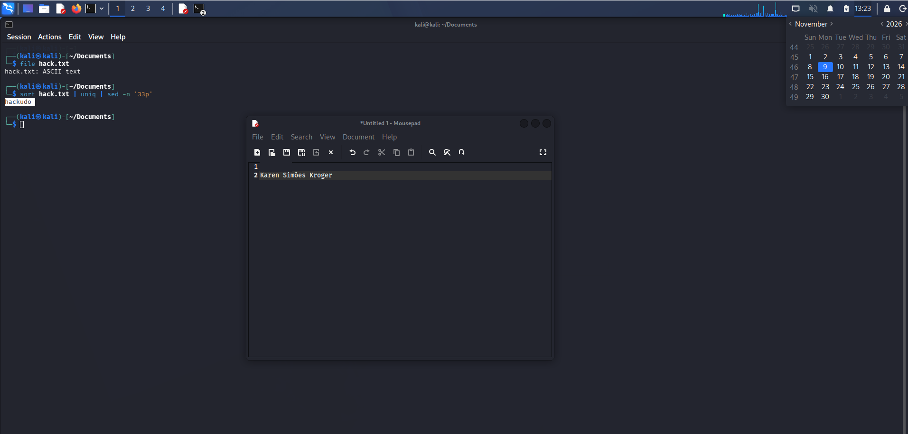

# CTF 3: Palavra escondida

**Categoria:** Manipulação de texto  
**Técnicas:** sort, uniq, sed

## Enunciado

Durante uma auditoria forense em sistemas comprometidos, foi localizado um arquivo contendo milhares de palavras repetidas e embaralhadas (hack.txt). Sabe-se que, ao aplicar filtros específicos para remover repetições, uma palavra crítica aparecerá exatamente na linha 33. A missão é descobrir qual é essa palavra.

## Objetivo

Filtrar o arquivo hack.txt, removendo as palavras repetidas, e identificar a palavra que ocupa a linha 33 da lista resultante.

## Resolução

1. Verificar o tipo do arquivo com file.
2. Ordenar as linhas com sort, agrupando as palavras iguais.
3. Remover as repetições com uniq.
4. Exibir somente a 33ª linha com sed -n '33p'.

### Comandos utilizados

```bash
file hack.txt
# hack.txt: ASCII text
sort hack.txt | uniq | sed -n '33p'
# Hackudo
```

### Explicação

O comando sort ordena as linhas do arquivo, agrupando as palavras iguais; o uniq remove as repetições adjacentes, deixando apenas uma ocorrência de cada palavra; e sed -n '33p' imprime somente a 33ª linha da lista resultante.

### Evidência



---

[↑ Voltar ao índice](README.md) · [← CTF 2](ctf-02-rastros-do-pinguim.md) · [CTF 4 →](ctf-04-palavras-ocultas.md)
