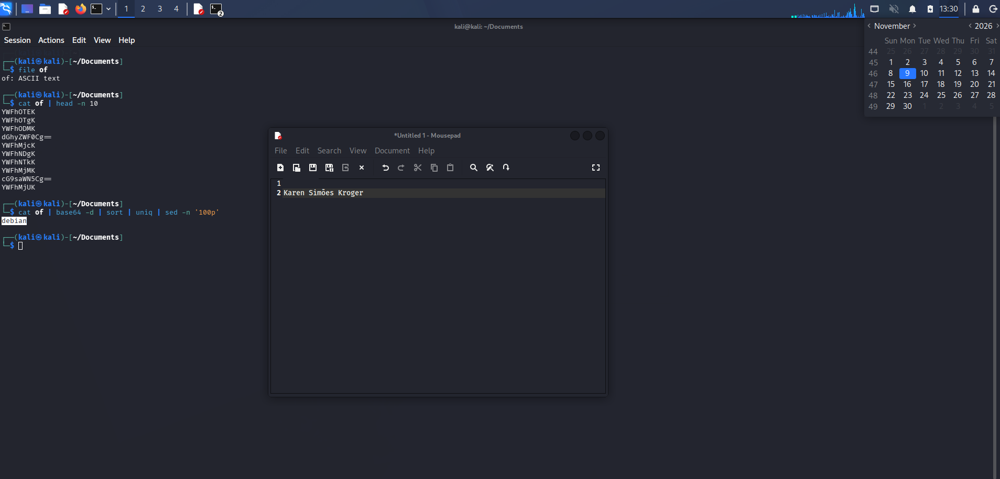

# CTF 4: Palavras ocultas

**Categoria:** Decodificação  
**Técnicas:** Base64 + filtragem

## Enunciado

Durante uma análise de atividades suspeitas, foi recuperado um arquivo chamado “of”. Sabe-se que o conteúdo foi previamente codificado. A missão é reconstruir as palavras originais, filtrar apenas as únicas e identificar qual palavra aparece na linha 100.

## Objetivo

Decodificar o conteúdo do arquivo of, filtrar as palavras únicas e identificar a palavra da linha 100.

## Resolução

1. Inspecionar as primeiras linhas com head e identificar a codificação Base64.
2. Decodificar o arquivo com base64 -d.
3. Ordenar e remover as duplicatas com sort e uniq.
4. Exibir a 100ª linha com sed -n '100p'.

### Comandos utilizados

```bash
file of
# of: ASCII text
cat of | head -n 10
# YWFhOTEK
# YWFhOTgK
# dGhyZWF0Cg==
# ...
cat of | base64 -d | sort | uniq | sed -n '100p'
# debian
```

### Explicação

A inspeção das primeiras linhas mostrou que cada palavra estava codificada em Base64. Como cada valor codificado já inclui a quebra de linha original, o arquivo inteiro pôde ser decodificado de uma vez com base64 -d. Em seguida, sort e uniq removeram as duplicatas e sed -n '100p' exibiu a 100ª palavra única.

### Evidência



---

[↑ Voltar ao índice](README.md) · [← CTF 3](ctf-03-palavra-escondida.md) · [CTF 5 →](ctf-05-criacao-de-usuario-suspeita.md)
