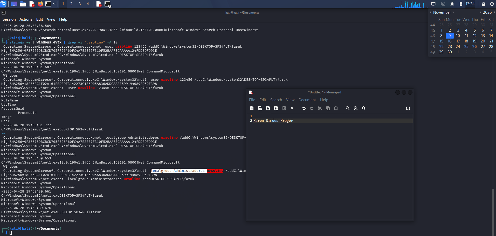

# CTF 5: Criação de usuário suspeita

**Categoria:** Forense Windows  
**Técnicas:** Logs Sysmon (.evtx), strings UTF-16

## Enunciado

Durante a auditoria de segurança em um ambiente Windows, foi identificado um evento relacionado à criação de novos usuários. O analista deverá examinar os registros para identificar qual usuário foi criado e em qual grupo foi incluído. Flag no formato FIAP{user_grupo}.

## Objetivo

Examinar o log de eventos do Windows (windows.evtx) para identificar o usuário criado e o grupo ao qual ele foi adicionado.

## Resolução

1. Identificar o arquivo como log de eventos do Windows com file.
2. Extrair as cadeias de texto em UTF-16 com strings -e l.
3. Buscar pelo usuário da máquina (faruk) e localizar o comando net user ursolino 123456 /add.
4. Buscar pelo novo usuário (ursolino) e localizar o comando net localgroup Administradores ursolino /add.

### Comandos utilizados

```bash
file windows.evtx
# MS Windows 10-11 Event Log, version 3.2, 1 chunks
strings -e l windows.evtx | grep -A 10 -i "Event" | head -n 50
strings -e l windows.evtx | grep -i "faruk" -A 10
# net.exe net user ursolino 123456 /add  DESKTOP-SP34PLT\faruk
strings -e l windows.evtx | grep -i "ursolino" -A 10
# net.exe net localgroup Administradores ursolino /add
```

### Explicação

O arquivo .evtx é um log de eventos do Windows (no caso, gerado pelo Sysmon). Como as cadeias de texto desse formato são gravadas em UTF-16 little-endian, foi utilizado strings -e l para extraí-las. A busca pelo usuário da máquina (faruk) revelou a execução do comando net user ursolino 123456 /add, e a busca pelo novo usuário mostrou, em seguida, o comando net localgroup Administradores ursolino /add, que o incluiu no grupo de administradores locais.

### Evidência



---

[↑ Voltar ao índice](README.md) · [← CTF 4](ctf-04-palavras-ocultas.md) · [CTF 6 →](ctf-06-filtragem-basica.md)
