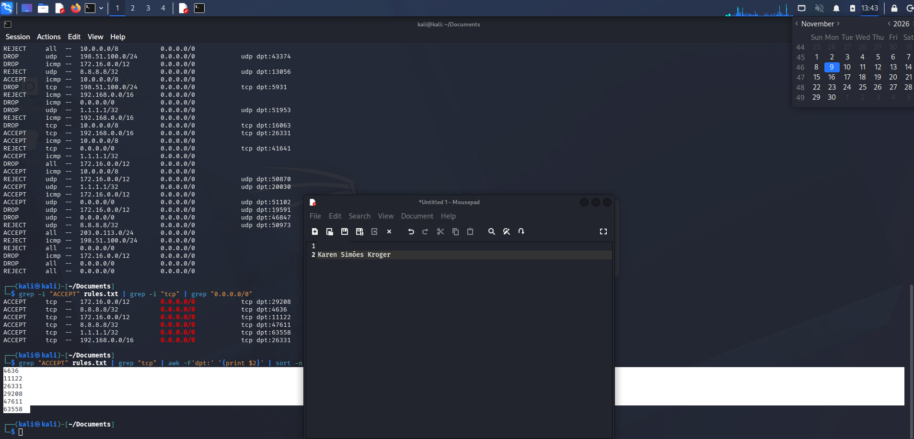

# CTF 7: Firewall auditor

**Categoria:** Firewall  
**Técnicas:** Auditoria de regras iptables

## Enunciado

Foi recebido o dump de firewall de um servidor Linux. A tarefa é encontrar todas as portas TCP que estão aceitando conexões com destino a qualquer rede (0.0.0.0/0). Flag no formato FIAP{porta,mais,baixa,para,mais,alta}.

## Objetivo

Analisar o dump de firewall rules.txt e listar, em ordem crescente, as portas TCP aceitas com destino a qualquer rede (0.0.0.0/0).

## Resolução

1. Verificar o tipo do arquivo com file.
2. Filtrar as regras ACCEPT do protocolo TCP com destino 0.0.0.0/0 usando grep.
3. Extrair o número da porta (dpt:) com awk.
4. Ordenar as portas numericamente com sort -n e montar a flag.

### Comandos utilizados

```bash
file rules.txt
# rules.txt: ASCII text
grep -i "ACCEPT" rules.txt | grep -i "tcp" | grep "0.0.0.0/0"
grep "ACCEPT" rules.txt | grep "tcp" | awk -F'dpt:' '{print $2}' | sort -n
# 4636
# 11122
# 26331
# 29208
# 47611
# 63558
```

### Explicação

Foram selecionadas apenas as regras com alvo ACCEPT e protocolo TCP cujo destino é 0.0.0.0/0. O awk, usando “dpt:” como separador, isolou o número da porta de destino, e sort -n ordenou os valores numericamente, do menor para o maior, conforme o formato exigido.

### Evidência



---

[↑ Voltar ao índice](README.md) · [← CTF 6](ctf-06-filtragem-basica.md) · [CTF 8 →](ctf-08-vigilancia-administrativa.md)
