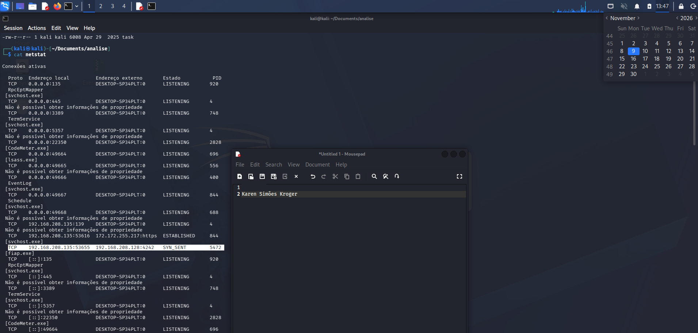

# CTF 8: Vigilância administrativa

**Categoria:** Forense de rede  
**Técnicas:** Correlação netstat × processos (C2)

## Enunciado

Foram fornecidos dois artefatos de uma máquina Windows: uma listagem de tarefas em execução (task) e o estado atual das conexões de rede (netstat). A missão é identificar o processo malicioso e descobrir o IP e a porta com os quais ele se comunica.

## Objetivo

Correlacionar a lista de processos (task) com as conexões de rede (netstat) para identificar o processo malicioso e o IP e a porta com os quais ele se comunica.

## Resolução

1. Acessar o diretório analise e listar os artefatos netstat e task.
2. Ler a saída do netstat e separar os serviços legítimos do Windows.
3. Identificar a conexão de saída suspeita em estado SYN_SENT do processo fiap.exe (PID 5472).
4. Registrar o IP e a porta remotos da conexão: 192.168.208.128:4242.

### Comandos utilizados

```bash
cd analise
ls -la
# netstat  task
cat netstat
grep "844" task
# svchost.exe   844 Services   0   63.964 K
```

### Explicação

Na saída do netstat, a maior parte das portas está em estado LISTENING e associada a serviços legítimos do Windows (svchost.exe, lsass.exe, CodeMeter.exe). O PID 844 corresponde a um svchost.exe legítimo com conexão HTTPS. Destaca-se, porém, o processo fiap.exe (PID 5472), que tenta abrir uma conexão de saída (SYN_SENT) a partir de 192.168.208.135:53655 para o endereço 192.168.208.128 na porta 4242, porta não padrão e típica de canais de comando e controle.

### Evidência



---

[↑ Voltar ao índice](README.md) · [← CTF 7](ctf-07-firewall-auditor.md) · [CTF 9 →](ctf-09-na-madruga.md)
