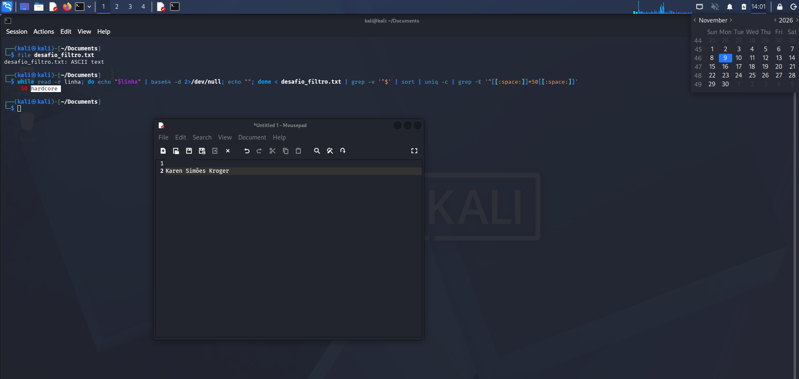

# CTF 14: Filtragem obscura

**Categoria:** Manipulação de texto  
**Técnicas:** Laço while, base64, uniq -c

## Enunciado

Foi interceptado um arquivo chamado desafio_filtro.txt, contendo milhares de palavras codificadas em Base64, incluindo palavras duplicadas e informações ocultas. A missão é descobrir qual palavra aparece exatamente 50 vezes no arquivo original (antes da codificação).

## Objetivo

Decodificar as palavras em Base64 do arquivo desafio_filtro.txt e identificar a palavra que aparece exatamente 50 vezes.

## Resolução

1. Verificar o tipo do arquivo com file.
2. Decodificar cada linha em um laço while com base64 -d.
3. Remover as linhas vazias e contar as ocorrências com sort | uniq -c.
4. Filtrar a contagem igual a 50 com grep -E.

### Comandos utilizados

```bash
file desafio_filtro.txt
# desafio_filtro.txt: ASCII text
while read -r linha; do
  echo "$linha" | base64 -d 2>/dev/null; echo ""
done < desafio_filtro.txt | grep -v '^$' | sort | uniq -c \
  | grep -E '^[[:space:]]*50[[:space:]]'
#      50 hardcore
```

### Explicação

Cada linha foi decodificada individualmente em um laço while, descartando erros de decodificação. As linhas vazias foram removidas com grep -v '^$', e o par sort | uniq -c contou as ocorrências de cada palavra. Por fim, a expressão regular selecionou apenas a contagem igual a 50.

### Evidência



---

[↑ Voltar ao índice](README.md) · [← CTF 13](ctf-13-elf.md) · [CTF 15 →](ctf-15-neon-scavenger.md)
